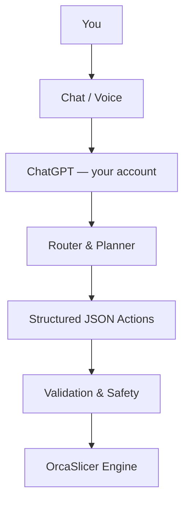

<div align="center">

<picture>
  
</picture>

[](https://github.com/HSU-LEE/VerSlicer/releases/latest) [](https://github.com/HSU-LEE/VerSlicer/stargazers) [-lightgrey)](#how-to-install) [](LICENSE)

VerSlicer: an [OrcaSlicer](https://github.com/OrcaSlicer/OrcaSlicer)-based slicer you can talk to.  
Just describe what you want — in chat or by voice — and VerSlicer turns it into real slicing actions on the plate you already use.

# Official links

<a href="https://github.com/HSU-LEE/VerSlicer"></a>
<a href="https://github.com/HSU-LEE/VerSlicer/releases/latest"></a>
<a href="https://github.com/HSU-LEE/VerSlicer/issues"></a>

</div>

# Demo

<div align="center">

<a href="https://www.youtube.com/watch?v=B7xJy94oYwg">
  
</a>

**▶ [Watch “VerSlicer — Just Say It.” on YouTube](https://www.youtube.com/watch?v=B7xJy94oYwg)**

</div>

# Main features

- **Natural-language control**  
  “Make this stronger”, “rotate it 45°”, “서포트 켜줘” — the assistant changes presets, plate layout and models through validated actions, in Korean or English.
- **Question and Apply modes**  
  Ask for advice without touching anything, or let the assistant apply changes. Setting changes always open a review dialog first.
- **Find & print from MakerWorld**  
  On an empty plate, “print me a dragon” searches MakerWorld, lets you pick a model, imports it, checks the mesh, configures and slices. You send it to the printer yourself.
- **Failed-print diagnosis**  
  “My print failed” reads the printer’s error code and HMS alerts, names the likely cause and the settings worth checking.
- **Printer control (opt-in)**  
  Once you allow it, the assistant can set the connected printer’s nozzle, bed and chamber target temperature and print speed level — always within the printer’s own limits. Turn it off in **Smart Print → Allow AI printer control**. Bambu printers with Authorization Control firmware may ignore these commands over the cloud; they apply over LAN with Developer Mode.
- **You stay in charge of printing**  
  The AI never sends a job to the printer and never creates or sculpts geometry.
- **Print to Bambu Lab printers without Developer Mode**  
  **Print with Bambu Connect** (the default for Bambu printers) hands the sliced plate to [Bambu Connect](https://wiki.bambulab.com/en/software/bambu-connect), Bambu Lab’s helper app for slicers other than Bambu Studio. Prefer direct LAN printing? Pick **Print plate** in the print button menu.
- **Voice input (macOS)**  
  Speak your request instead of typing it.
- **Rollback**  
  Undo the last AI settings change with one request.
- **Everything OrcaSlicer does**  
  Calibration tools, seam and wall control, supports, network printers and the full printer profile library are unchanged underneath.

# Download

## Stable Release

📥 **[Download the Latest Stable Release](https://github.com/HSU-LEE/VerSlicer/releases/latest)**  
Recommended for most users. See [CHANGELOG.md](CHANGELOG.md) for what changed.

# How to install

## Mac

1. Download the **PKG** or **DMG** (Apple Silicon, macOS 11.3 or later) from the [releases page](https://github.com/HSU-LEE/VerSlicer/releases/latest).
2. **PKG:** right-click it → **Open** (the installer is not signed yet), then follow the steps. **DMG:** open it and drag **VerSlicer.app** to the Applications folder.
3. Releases are not yet signed with an Apple Developer ID, so macOS may block the first launch. If it says VerSlicer **is damaged** or **can’t be opened**, open **Terminal** (Applications → Utilities), paste this line and press Return:

    ```bash
    xattr -dr com.apple.quarantine /Applications/VerSlicer.app
    ```

    Then open VerSlicer again. You only need to do this once per download. (Alternatively, right-click the app → **Open** → **Open**, or use **Open Anyway** in System Settings → Privacy & Security.)

Windows and Linux builds are not available yet.

# How to use

### 1. Connect ChatGPT

Open the **AI assistant** on the 3D view toolbar and press **Connect ChatGPT**. A one-time notice explains what is sent to OpenAI; after you agree, the browser opens. Sign in and allow VerSlicer. A ChatGPT Plus or Pro plan is required.

### 2. Talk to it

| Mode | What happens |
| --- | --- |
| **Question** | Explanations only; nothing on the plate changes |
| **Apply** | The assistant applies validated actions on the slicer |

Try: *“Increase infill to 30%”*, *“Make this stronger”*, *“Rotate it 45 degrees”*, *“용 피규어 출력해줘”*, *“My print failed”*.

### 3. Print

Slice the plate, then press **Print with Bambu Connect**. VerSlicer opens the sliced file in [Bambu Connect](https://wiki.bambulab.com/en/software/bambu-connect#download) (free, macOS 13 or later), where you pick the printer and start the print. Recent Bambu Lab firmware only accepts jobs from slicers other than Bambu Studio this way, unless the printer is in LAN mode with Developer Mode on — then **Print plate** sends directly.

### 4. Voice

Allow Microphone and Speech Recognition when asked. For Korean, put Korean above English in **System Settings → General → Language & Region**.

# Privacy and safety

- **ChatGPT** — Your requests and plate context (model names, sizes, current settings) go to OpenAI under your ChatGPT account. Model files (STL/3MF) and G-code are never sent.
- **Consent first** — Nothing goes to OpenAI until you accept the in-app data notice. It is asked once.
- **Your sign-in stays on this Mac** — Tokens are kept in a file only your macOS user can read (`~/Library/Application Support/verslicer/chatgpt_account.json`); **Sign out** removes them. There is no VerSlicer server.
- **Allow-listed actions** — Only registered action types run, with checked parameters and setting keys. Settings, presets, export, save and delete go through a review dialog.
- **No sending, no modeling** — No AI tool sends to the printer or creates geometry; menu items that print, send or upload are blocked for the AI.
- **Crash reports stay local** — After a crash, the next launch offers to open a prefilled GitHub issue that you review before submitting.

<details>
<summary><b>How it works (architecture)</b></summary>



1. **You** type or speak on the 3D view chat panel.
2. **Router** picks single-shot, the multi-step assist loop, the diagnostic pipeline, or the find-and-print orchestrator.
3. **ChatGPT** returns a short message plus typed actions — never raw G-code.
4. **Validator** checks action types, parameters and preset keys against a fixed registry.
5. **Executor** applies them on the live plater.

| Layer | Role |
| --- | --- |
| **Chat / Voice UI** | `OllamaChatPanel` — modes, streaming, pipeline stepper, MakerWorld pick dialog |
| **Assist loop** | Multi-step agent: observe → plan → act (up to 40 steps) |
| **Diagnostic pipeline** | Quality complaints with Bambu Lab Wiki evidence |
| **Print job orchestrator** | Find → import → slice (stops before sending) |
| **Action executor** | Maps JSON actions to `Plater`, preset and device calls |
| **OrcaSlicer core** | Unchanged slicing, profiles and device stack |

The model replies with one JSON object:

```json
{
  "message": "I'll stiffen the part with more walls and higher infill.",
  "actions": [
    { "type": "set_config", "preset": "print",
      "options": { "sparse_infill_density": "30%", "wall_loops": 4 } }
  ]
}
```

Common action types: `set_config`, `rotate`, `translate`, `scale`, `arrange`, `slice`, `makerworld_find_and_print`, `repair_mesh`, `printer_control`, `printer_diagnostics`, `rollback_apply` — see `OllamaActionRegistry` for the full allow-list.

</details>

<details>
<summary><b>Configuration</b></summary>

Settings live in `~/Library/Application Support/verslicer/verslicer.conf` under `"ollama"` (the name is kept from earlier versions).

| Setting | Default | Notes |
| --- | --- | --- |
| Model | first model on your ChatGPT plan | Pick another in the model dropdown |
| Assist loop | on | Up to 40 steps |
| Wiki search | on | Quality diagnostics |
| Print job orchestrator | on | Find & print |
| Printer control | off until you allow it | Smart Print → Allow AI printer control |
| MCP server | off | Local agents (Cursor etc.) |

Environment overrides: `OLLAMA_ASSIST_LOOP`, `OLLAMA_ASSIST_MAX_STEPS`, `OLLAMA_WIKI_SEARCH`, `VERSLICER_MCP_SERVER`.

</details>

# How to Compile

**Requirements:** macOS 11.3+, Xcode or Command Line Tools, CMake 3.13+.

```bash
./scripts/setup_dev_env.sh          # ccache, ninja, clangd
./build_release_macos.sh -d -x      # dependencies (once)
./build_dev_macos.sh                # Debug app → build/<arch>-dev/src/verslicer.app
./scripts/run_orca_tools_test.sh    # headless tests
./scripts/make_macos_installer.sh --build   # Release app + DMG → build/<arch>/dist/
```

Release process (signing, notarization, tagging): [docs/RELEASING.md](docs/RELEASING.md). Manual checks before a release: [docs/QA_CHECKLIST.md](docs/QA_CHECKLIST.md).

# Supported printers

VerSlicer inherits **OrcaSlicer’s full printer profiles**. Bambu Lab printers print through Bambu Connect (or directly over LAN with Developer Mode) and get failed-print diagnosis and printer control; other printers still slice, send through their usual print host, and get the assistant’s settings help.

# Some Background

Open-source slicing has always been built on collaboration and attribution. [Slic3r](https://github.com/Slic3r/Slic3r) laid the foundation; [PrusaSlicer](https://github.com/prusa3d/PrusaSlicer), [Bambu Studio](https://github.com/bambulab/BambuStudio) and [SuperSlicer](https://github.com/supermerill/SuperSlicer) carried it forward, and [OrcaSlicer](https://github.com/OrcaSlicer/OrcaSlicer) grew into one of the most widely used open-source slicers.

**VerSlicer** adds a natural-language layer on top of that engine — so you spend less time hunting settings and more time printing.

# License

VerSlicer is based on OrcaSlicer and, like it, is licensed under the **GNU Affero General Public License, version 3** ([LICENSE](LICENSE)). AI and UI additions are copyright **Lee Hee Seung**; see [NOTICE](NOTICE) for attribution and trademarks.

VerSlicer is not affiliated with OpenAI or Bambu Lab. “ChatGPT” is a trademark of OpenAI; “Bambu Lab” and “MakerWorld” are trademarks of Bambu Lab.
